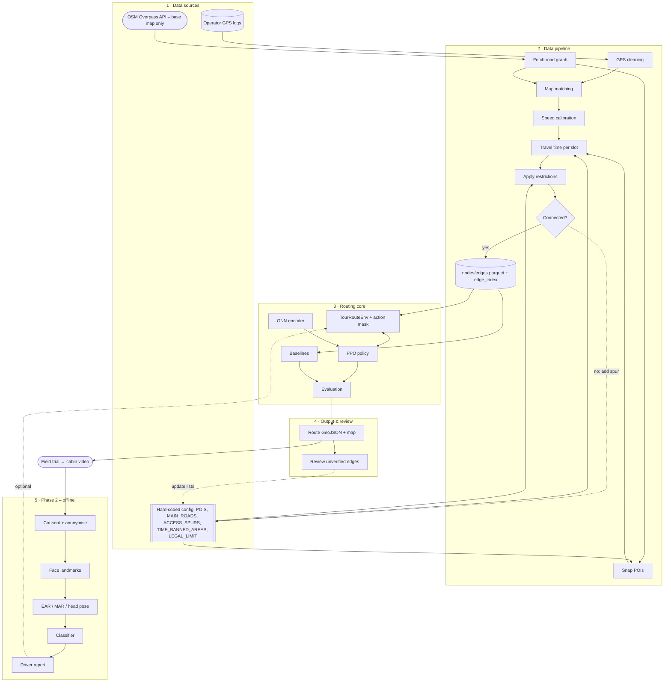

# Architecture – COS40005

> Đọc cùng `PROJECT_CONTEXT.md`. File này mô tả **các lớp của hệ thống**, **luồng dữ liệu** và **source code nằm ở đâu**.

## 1. Sơ đồ tổng thể

Bản chi tiết hơn (có ghi chú từng bước) nằm ở `docs/architecture.mmd`. GitHub và VS Code (extension Markdown Preview Mermaid) hiển thị được sơ đồ dưới đây.



## 2. Các lớp

| Lớp | Vai trò | Module | Đầu vào → Đầu ra |
|---|---|---|---|
| **1. Data sources** | Nguồn duy nhất của sự thật | `dataset/`, OSM API, `src/busroute/config/` | — |
| **2. Data pipeline** | Biến dữ liệu thô thành đồ thị có trọng số theo giờ | `busroute.gps`, `busroute.graph` | CSV + OSM → `nodes.parquet`, `edges.parquet`, `edge_index.npy` |
| **3. Routing core** | Học chính sách chọn đường (PPO + GNN), so với baseline | `busroute.routing` | Dataset đồ thị → lộ trình và chỉ số |
| **4. Output & review** | Xuất lộ trình, vẽ bản đồ, kiểm tra các đoạn chưa được GPS xác nhận | `busroute.viz`, `routing.evaluate` | Lộ trình → GeoJSON/HTML, danh sách cần kiểm tra |
| **5. Phase 2** | Phân tích khuôn mặt tài xế từ video chạy thử | `driverface` | Video → đặc trưng → nhãn buồn ngủ/mất tập trung |

**Hai vòng phản hồi:**
- **Vòng ràng buộc:** routing → các đoạn chưa xác nhận → kiểm tra Street View / tài xế → cập nhật `config/roads.py` → build lại đồ thị.
- **Vòng phase 2 (tùy chọn):** mức mệt mỏi của tài xế → điều chỉnh ngân sách thời gian hoặc phần thưởng trong `TourRouteEnv`.

## 3. Pipeline dữ liệu – chi tiết

| Bước | Hàm | File | Ghi chú |
|---|---|---|---|
| 1. Clean GPS | `clean_file()` | `gps/clean.py` | dedup → khôi phục giây → bỏ điểm cách > 100 km → bỏ điểm > 120 km/h → haversine → tách chuyến/điểm dừng |
| 1b. Map matching | `match_points()` | `gps/map_match.py` | Nearest edge; nâng cấp lên HMM sau |
| 1c. Calibration | `collect_edge_speeds()`, `fit_calibration()` | `gps/speed_calibration.py` | Hệ số = tốc độ thực / giới hạn luật |
| 2. Road graph | `fetch_road_graph()` | `graph/osm_fetch.py` | OSMnx, `network_type="drive"`, cache, SCC lớn nhất |
| 3. POIs | `snap_pois()` | `graph/poi_snap.py` | POI > 300 m tới đường → kiểm tra tay |
| 4. Travel time | `add_travel_times()` | `graph/travel_time.py` | GPS (≥ `MIN_GPS_SAMPLES`) hoặc giới hạn luật × hệ số; chặn trên bởi Thông tư 38/2024 |
| 5. Restrictions | `apply_restrictions()`, `is_edge_allowed()` | `graph/restrictions.py` | Whitelist (xoá cạnh) + `blocked_<slot>` cho giờ cấm |
| 5b. Connectivity | `check_connectivity()` | `graph/connectivity.py` | POI bị tách → thêm `ACCESS_SPURS` |
| 6. Export | `export_graph()` | `graph/export.py` | Parquet + `edge_index.npy` cho PyG |

**Khung giờ** (`utils/timeslots.py`): `morning 05:00–10:30`, `ban_noon 10:30–12:00`, `afternoon 12:00–16:30`, `ban_evening 16:30–19:00`, `night 19:00–24:00`. Mỗi cạnh có `travel_time_<slot>` và `blocked_<slot>`.

## 4. Routing core – thiết kế

```
Episode = (A, B, time budget, start time) sampled at random
  obs  = {current node, time left ratio, minute of day, visited POIs, action mask}
  GNN  : node features (lat, lon, is_poi, poi_score, …) → node embeddings   [once per graph]
  head : score each candidate out-edge = f(emb[current], emb[next], edge feats, global feats)
         logits[mask == False] = -inf
  step : elapsed += travel_time_<slot>; +poi_score on first pass; −0.01/min
  end  : reached B (+10) | over budget or stuck (−20)
```

**Baseline:** `shortest_path_route` (Dijkstra) và `greedy_poi_route` (điểm/thời gian). **Chỉ số:** tổng phút, có nằm trong ngân sách không, số POI, tổng điểm POI, số đoạn chưa được GPS xác nhận.

## 5. Cấu trúc source code

```
COS40005/source_code/
├── dataset/                    # log GPS gốc của nhà xe (KHÔNG commit)
├── PROJECT_CONTEXT.md          # bối cảnh dự án – đưa cho AI đọc trước
├── README.md                   # cài đặt & cách chạy
├── pyproject.toml              # cài package: pip install -e .
├── requirements.txt
├── .gitignore                  # chặn data/, video, *.csv, *.zip
├── configs/
│   └── settings.yaml           # tham số chạy (OSM place, ngân sách, PPO)
├── docs/
│   ├── ARCHITECTURE.md         # file này
│   └── architecture.mmd        # sơ đồ chi tiết (Mermaid) – mở bằng draw.io: Arrange › Insert › Advanced › Mermaid
├── data/                       # KHÔNG commit (xem data/README.md)
│   ├── raw/gps/  interim/gps/  processed/  cache/  video/
├── src/
│   ├── busroute/               # ===== Phase 1 – routing =====
│   │   ├── config/             # ★ mọi thứ viết cứng
│   │   │   ├── pois.py         #   POIS
│   │   │   ├── roads.py        #   MAIN_ROADS, ACCESS_SPURS, BLOCKED_WAYS
│   │   │   ├── restrictions.py #   TIME_BANNED_AREAS, BOUNDARY_POLYGON
│   │   │   └── speeds.py       #   LEGAL_LIMIT_KMH, ROAD_LIMIT_CLASS, CALIBRATION
│   │   ├── utils/
│   │   │   ├── geo.py          #   haversine_m, point_in_polygon, normalize_road_name
│   │   │   └── timeslots.py    #   TIME_SLOTS, in_windows, slot_of
│   │   ├── gps/
│   │   │   ├── clean.py        #   Bước 1
│   │   │   ├── map_match.py
│   │   │   └── speed_calibration.py
│   │   ├── graph/
│   │   │   ├── osm_fetch.py    #   Bước 2
│   │   │   ├── poi_snap.py     #   Bước 3
│   │   │   ├── travel_time.py  #   Bước 4
│   │   │   ├── restrictions.py #   Bước 5 (+ is_edge_allowed cho action mask)
│   │   │   ├── connectivity.py
│   │   │   └── export.py       #   Bước 6
│   │   ├── routing/
│   │   │   ├── env.py          #   TourRouteEnv
│   │   │   ├── gnn.py          #   GraphEncoder, PolicyValueHead
│   │   │   ├── ppo_train.py    #   GAE, PPO loss, train() [TODO]
│   │   │   ├── baselines.py    #   Dijkstra, greedy
│   │   │   └── evaluate.py     #   route_metrics
│   │   └── viz/
│   │       └── route_map.py    #   folium
│   └── driverface/             # ===== Phase 2 – offline only =====
│       ├── README.md           #   quy tắc dữ liệu & pháp lý
│       └── features.py         #   EAR, MAR, PERCLOS
├── scripts/
│   ├── run_clean_gps.py        # Bước 1 cho mọi file, ẩn danh biển số
│   ├── build_graph.py          # Bước 2–6
│   └── train_ppo.py            # huấn luyện
└── tests/
    ├── test_geo.py
    └── test_restrictions.py
```

**Quy tắc phụ thuộc:** `config` và `utils` không import gì trong dự án. `gps` và `graph` chỉ import `config` và `utils`. `routing` chỉ đọc **dataset đã xuất**, không gọi OSM. `driverface` độc lập hoàn toàn với `busroute`.

## 6. Gợi ý chia việc (5 người)

| Thành viên | Phần | Thư mục |
|---|---|---|
| 1 | GPS + map matching + hiệu chỉnh tốc độ | `gps/` |
| 2 | Đồ thị OSM, POI, ràng buộc, kiểm tra liên thông | `graph/`, `config/` |
| 3 | Khảo sát thực địa: phỏng vấn tài xế, Street View, điền `config/` | `config/` |
| 4 | Môi trường RL + PPO + GNN | `routing/` |
| 5 | Baseline, đánh giá, bản đồ, báo cáo & slide; sau đó dẫn Phase 2 | `routing/baselines.py`, `evaluate.py`, `viz/`, `driverface/` |

## 7. Trạng thái

| Module | Trạng thái |
|---|---|
| `gps/clean.py`, `utils/*`, `graph/*`, `routing/env.py`, `baselines.py`, `evaluate.py`, `viz/` | Có code chạy được, cần thử trên dữ liệu thật |
| `config/*` | Có khung; **các danh sách và đa giác phải do nhóm điền** (các mục `TODO`) |
| `gps/map_match.py` | Bản đơn giản (nearest edge) |
| `routing/gnn.py`, `ppo_train.py` | Khung; `train()` chưa viết |
| `driverface/` | Mới có hàm đặc trưng; chờ video |
