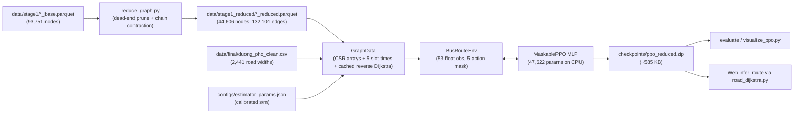

# PPO routing on the reduced road graph

This document describes the Proximal Policy Optimization (PPO) solver used in
this repository: how the road network is reduced, how the Gymnasium MDP and
action masking work, the neural network architecture, the episode-batch training
loop, why CPU training runs quickly, benchmark results, and how checkpoints are
visualized and served in the web application.

## 1. Overview and end-to-end architecture

The PPO agent solves a time-budgeted tourist-bus orienteering problem **edge by
edge** on Da Nang's directed road network: starting at a point of interest (POI)
`A` at a local departure time and given a travel-time budget, the bus chooses
outgoing road segments one intersection at a time to maximize total unique POI
score while avoiding narrow roads (`< 5.5 m` for a 45-seat tour bus) and
reaching destination POI `B` within budget.



### Module map

| Component | Path | Responsibility |
|---|---|---|
| Lossless graph reducer | `src/busroute/graph/reduce.py` | `prune_dead_ends`, `contract_chains`, `reduce_graph` |
| Reduction CLI & check | `scripts/reduce_graph.py` | Build `stage1_reduced` Parquet files and verify 0 m shortest-path error |
| Graph container & MDP | `src/busroute/routing/ppo_env.py` | `GraphData` (CSR, slot times, cached Dijkstra) and `BusRouteEnv` |
| Episode-batch PPO & Web inference | `src/busroute/routing/ppo_train.py` | `run_episode`, `compute_gae`, `update_policy`, `train`, `evaluate`, `infer_route`, heuristic baselines |
| Web router dispatch | `src/busroute/routing/road_dijkstra.py` | `find_route(..., algorithm="ppo")` delegating to `infer_route` |
| Training CLI | `scripts/ppo_train.py` | CLI flags, training loop invocation, and JSON benchmark export |
| Replay visualization | `src/busroute/viz/ppo_viz.py`, `scripts/visualize_ppo.py` | MapLibre GL JS HTML replay (`via_nodes` geometry) and 3-panel PNG summary |
| Tests | `tests/test_ppo_env.py`, `tests/test_web_orienteering.py` | Action masking, road-width penalties, GAE math, smoke training, Web worker integration |

---

## 2. Graph reduction (`src/busroute/graph/reduce.py`, `scripts/reduce_graph.py`)

Running `python scripts/reduce_graph.py` reads `data/stage1/{nodes,edges}_base.parquet`
and writes `data/stage1_reduced/{nodes,edges}_reduced.parquet`. Before reduction,
all configured POIs and hubs are snapped to base road nodes and marked as
**protected** so they can never be deleted or contracted away.

Reduction runs two lossless passes (`reduce_graph`):

1. **`prune_dead_ends`**: iteratively removes unprotected degree-1 dead-end
   nodes, since a shortest path between two distinct other nodes never enters a
   dead end only to turn back along the same road.
2. **`contract_chains`**: contracts unprotected degree-2 pass-through nodes
   `a -> x -> b` into a single edge `a -> b` with summed `length_m`, provided
   there are no parallel edges, one-way consistency holds (`a->x` iff `x->b`,
   and similarly `b->x` iff `x->a`), and—under default `strict=True`—both
   segments share `road_class` and `road_name` (passing `--relaxed` removes the
   same-class/name restriction).
3. **Final dead-end sweep + reindexing**: runs `prune_dead_ends` once more,
   renumbers surviving nodes `0..N-1` while keeping `orig_node_idx`, and records
   every contracted intermediate node ID in semicolon-delimited `via_nodes` so
   full road geometry can be reconstructed later.

| Stage | Nodes | Edges | Notes |
|---|---:|---:|---|
| Original (`stage1`) | 93,751 | — | Full directed base graph |
| After pruning dead ends | 62,424 | — | Unprotected degree $\le 1$ removed |
| After strict contraction (default) | 44,606 (47.6%) | 132,101 | Max out-degree `K = 5`, 49 snapped POI nodes, 21,878 known-width edges |
| After relaxed contraction (`--relaxed`) | 43,603 (46.5%) | — | Drops same `road_class` + `road_name` constraint |

Both passes are lossless for shortest paths: `check_distances` on 150 random
sources verifies **0.000000 m** maximum distance error, identical reachability,
and a single strongly connected component. Going below ~46% would require lossy
steps such as dropping minor streets, so reduction stops here.

---

## 3. Environment and MDP formulation (`src/busroute/routing/ppo_env.py`)

### 3.1 `GraphData`: shared immutable graph state

`GraphData.load()` loads the reduced Parquet files once into contiguous NumPy
and SciPy CSR arrays shared read-only across environments (never copied per
step):

- **CSR topology**: edges sorted by `(from_idx, to_idx)` with `indptr`, `src`,
  `dst`, `length`, `coords`, `via_nodes`, `road_label`, and `max_degree` (`K = 5`).
- **Road widths**: loaded from `data/final/duong_pho_clean.csv` (2,441 rows) via
  `road_widths()` and `normalize_road_name()`. Edges with unambiguous matches
  get `width` in metres; `narrow` flags `width < 5.5` m (`NARROW_WIDTH_M = 5.5`,
  sized for a 45-seat tour bus). Unknown widths stay `NaN`.
- **Slot-dependent travel times**: `time[slot] = length * s_per_m[slot][group]`
  using `GROUP_OF` and `configs/estimator_params.json` across the 5 daily time
  slots (`morning`, `ban_noon`, `afternoon`, `ban_evening`, `night`).
- **Cached reverse Dijkstra**: `_rev[slot]` stores a transposed `csr_matrix` of
  minimum edge travel times between node pairs.
  - `to_target(slot, target)` runs SciPy's C-compiled `dijkstra` on `_rev[slot]`
    from `target` and memoizes the resulting distance array of length `n` in
    `_to_target[(slot, target)]`. Across 49 POIs × 5 slots there are at most
    **245** possible keys.
  - `to_nearest(slot, nodes)` computes multi-source shortest time from every node
    to the nearest unvisited intermediate POI (`min_only=True`).

### 3.2 Episode initialization (`BusRouteEnv.reset`)

Each episode samples:
- Two distinct snapped POI nodes `(A, B)` (unless overridden via `options` for
  evaluation or web inference).
- Departure minute `start_minute` uniformly in `[06:00, 20:00)`.
- Time budget `budget = direct(slot0, A -> B) * U(1.3, 2.5) + 15 min`, where
  `max_episode_steps = 1000`.
- The starting POI `A` is marked collected on reset (no step-0 reward) and
  `poi_field` is initialized for the remaining intermediate POIs.

### 3.3 Action space and action masking

At node `cur` with outgoing edges `indptr[cur] : indptr[cur + 1]` (at most `K = 5`
slots), the action space is `Discrete(5)`. Before every action, `_candidates()`
computes the boolean action mask using the current time slot `slot`:

$$\text{slack}_j = \text{budget} - \text{elapsed} - t_j - 1.05 \cdot \text{to\_target}(\text{slot}, B)[\text{to}_j]$$

An outgoing edge slot `j` is valid (`mask[j] = True`) iff `slack_j >= 0` (and
padded slots beyond the node's out-degree remain `False`). If no outgoing edge
passes the 5% `safety_margin = 1.05`, the fallback unmasks only the single edge
minimizing `t_j + back_j` so `mask.any()` is always `True`. Selecting a masked
action raises `ValueError`.

### 3.4 Observation space (`Box(53,)`, `float32`)

The observation vector has fixed length `K * EDGE_FEATURES + GLOBAL_FEATURES = 5 * 9 + 8 = 53`
(padded with zeros when a node has fewer than 5 outgoing edges):

**Per-edge features (`EDGE_FEATURES = 9`, repeated for `K = 5` slots → 45 values)**

| Offset | Description |
|---:|---|
| `0` | Valid action mask flag (`1.0` if valid, `0.0` otherwise) |
| `1` | Normalized edge length: `min(length_m / 1000.0, 5.0)` (km, capped at 5) |
| `2` | Normalized edge travel time: `min(t / 600.0, 5.0)` (10-min units, capped at 5) |
| `3` | Target progress rate: `clip((here_back - back) / max(t, 1e-6), -1, 1)` (`1` = on shortest path to `B`) |
| `4` | Intermediate-POI progress rate: `clip((here_poi - poi_to) / max(t, 1e-6), -1, 1)` (`0` if `inf`) |
| `5` | Uncollected POI score immediately at `to`: `sum(poi_score) / 5.0` |
| `6` | Revisit flag: `1.0` if `to` was already visited in this episode |
| `7` | Narrow-road flag: `1.0` if `width < 5.5` m (`0.0` otherwise) |
| `8` | Normalized width: `clip(width / 15.0, 0, 1)` when known, else `7.5 / 15.0 = 0.5` |

**Global features (`GLOBAL_FEATURES = 8` → indices `45..52`)**

| Index | Description |
|---:|---|
| `45` | Remaining budget fraction: `remain / budget` |
| `46` | Slack fraction: `clip((remain - here_back) / budget, 0, 1)` |
| `47` | Direct-back fraction: `clip(here_back / budget, 0, 1)` |
| `48` | Time-of-day sine: `sin(2 * pi * minute_of_day / 1440)` |
| `49` | Time-of-day cosine: `cos(2 * pi * minute_of_day / 1440)` |
| `50` | Nearest uncollected POI fraction: `clip(here_poi / budget, 0, 1)` (`1.0` if none left) |
| `51` | Fraction of all POIs collected so far: `collected.mean()` |
| `52` | Step budget progress: `steps / max_episode_steps` |

### 3.5 Step reward function

Each step moving along edge $e_t$ (duration $\Delta t_{\text{min}} = t / 60$,
length $\ell_{\text{km}} = \text{length} / 1000$, width $w$) receives:

$$r_t = -0.01 \cdot \Delta t_{\text{min}} + 0.02 \cdot (\text{dist\_poi}(s_t) - \text{dist\_poi}(s_{t+1}))_{\text{min}} + r_{\text{width}}(e_t) - 0.02 \cdot \mathbf{1}_{\text{revisit}} + \text{poi\_score} + 1.0 \cdot \mathbf{1}_{\text{reached } B} - 5.0 \cdot \mathbf{1}_{\text{failed}}$$

where the potential-based shaping uses the *same* `poi_field` snapshot on both
endpoints (refreshing `poi_field` only *after* collecting a new POI), and the
non-positive width penalty $r_{\text{width}}(e_t)$ is:

- $w \ge 5.5\text{ m}$: $0$
- $w < 5.5\text{ m}$: $-1.0 \cdot \ell_{\text{km}} \cdot \left(1 + \frac{5.5 - w}{5.5}\right)$
- unknown $w$: $-0.05 \cdot \ell_{\text{km}}$

---

## 4. Policy and value network architecture (`MaskablePPO`)

`train()` instantiates `sb3_contrib.MaskablePPO("MlpPolicy", ..., device="cpu")`
solely as a shell for the actor-critic neural network, Adam optimizer, and `.zip`
serialization (`model.save` / `MaskablePPO.load`)—it does **not** call SB3's
`.learn()`.

With default `hidden = 128`, `policy_kwargs={"net_arch": {"pi": [128, 128], "vf": [128, 128]}}`
creates two separate 2-layer `Tanh` MLPs (verified from `checkpoints/ppo_reduced.zip`):

| Network | Layer shapes | Parameters |
|---|---|---:|
| Actor (`pi`) | `53 → 128` (`6,784 + 128`), `128 → 128` (`16,384 + 128`), `128 → 5` (`640 + 5`) | **24,069** |
| Critic (`vf`) | `53 → 128` (`6,784 + 128`), `128 → 128` (`16,384 + 128`), `128 → 1` (`128 + 1`) | **23,553** |
| **Total** | | **47,622** |

Because the model has only **47,622 parameters** (~195 KB `policy.pth`; ~585 KB
checkpoint `.zip` with optimizer state), running on CPU avoids host-to-GPU
transfer overhead that would slow down single-observation rollouts.

---

## 5. Episode-batch PPO training algorithm (`src/busroute/routing/ppo_train.py`)

Training follows the hierarchy **Epoch > Episode > Step**. Each epoch executes
three explicit phases:

1. **Phase 1 — Collect complete episodes (`run_episode`)**:
   Runs `episodes_per_epoch` complete `POI A → POI B` trips with the policy
   frozen under `torch.no_grad()`, recording `(obs, act, mask, logp, value, reward)`
   at every step. When an episode ends by reaching `B` or running late
   (`terminated`), `last_value = 0.0`; only if cut off at `max_episode_steps`
   (`truncated`) does it bootstrap `last_value = policy.predict_values(obs)`.
2. **Phase 2 — Per-episode GAE (`compute_gae`)**:
   Walks backward from the final step of each episode so POI scores collected
   late in a trip propagate credit back to earlier routing choices:
   $$\delta_t = r_t + \gamma V(s_{t+1}) - V(s_t), \qquad A_t = \delta_t + \gamma \lambda A_{t+1}, \qquad R_t = A_t + V(s_t)$$
   Default `gamma = 0.995` (high because POI rewards arrive over hundreds of
   steps) and `gae_lambda = 0.95`.
3. **Phase 3 — One-shot PPO-clip update (`update_policy`)**:
   Concatenates all episodes from the epoch into one batch, normalizes
   advantages across the batch, and runs `update_passes` (default `6`) shuffled
   minibatch epochs (`batch_size = 256`, `learning_rate = 3e-4`) optimizing:
   $$\mathcal{L} = -\mathbb{E}\!\left[\min\!\big(r_t(\theta)\hat{A}_t,\; \text{clip}(r_t(\theta), 1-\epsilon, 1+\epsilon)\hat{A}_t\big)\right] + c_v\,\text{MSE}(V_\theta(s_t), R_t) - c_e\,\mathcal{H}(\pi_\theta(\cdot \mid s_t, \text{mask}_t))$$
   with `clip_range = 0.2`, `vf_coef = 0.5`, `ent_coef = 0.01`, and gradient
   norm clipping `max_grad_norm = 0.5`. The batch is then discarded before the
   next epoch.

### Why training is fast on CPU

Even with `100` epochs × `100` episodes, training completes in roughly ~1 hour on
a laptop CPU (e.g., Intel Core i5-1245U) because:

1. **Tiny MLP & observation**: 53 input floats through 47,622 parameters runs in
   microseconds on CPU without PCIe/CUDA kernel-launch overhead.
2. **Zero-copy NumPy stepping**: `BusRouteEnv` reads shared CSR arrays in
   `GraphData` with no graph copying or rendering.
3. **Reduced graph**: graph reduction cuts node count to 47.6% (`44,606` nodes),
   roughly halving trip step counts and Dijkstra cost.
4. **Memoized reverse Dijkstra**: `to_target()` hits SciPy's C `dijkstra` at most
   `49 × 5 = 245` times across the entire run, then becomes an O(1) dictionary
   lookup; `to_nearest()` only recomputes on `reset()` and POI collection.
5. **Action-masked horizon**: masking infeasible detours prevents random
   wandering to `max_episode_steps = 1000`. In the 50-epoch × 100-episode run in
   `test_train.txt`, 5,000 episodes totaled 1,085,507 steps (**~217 steps/episode**
   average), so 100 × 100 episodes is ~2.2M lightweight steps.
6. **Batch-once-per-epoch updates**: gradient backward passes run only after an
   entire epoch of episodes is collected (6 passes over ~21.7K steps ≈ ~510 tiny
   minibatches per epoch).

---

## 6. Baselines, evaluation, and benchmark results

`evaluate()` tests every policy on the same fixed `episodes` scenarios (`seed + ep`):

- `random` (`_pick_random`): uniform sample among valid unmasked actions.
- `shortest` (`_pick_shortest`): picks the valid edge with maximum target
  progress feature (`feat[:, 3]`).
- `greedy` (`_pick_greedy`): scores valid edges with the hand-crafted linear
  heuristic `10 * f[:, 5] + f[:, 4] + 0.01 * f[:, 3] - 0.1 * f[:, 6] - 0.2 * f[:, 7]`
  (immediate POI, intermediate-POI progress, target progress, minus revisit and
  narrow-road penalties).
- `ppo` (`_pick_ppo`): deterministic `MaskablePPO.predict(..., deterministic=True)`.

Results recorded in `results/ppo_reduced.json` (30 fixed evaluation episodes):

| Policy | Mean POI score | Mean POIs | Mean narrow-road distance | Success rate |
|---|---:|---:|---:|---:|
| `random` | 17.44 | 3.97 | 91.85 m | 96.7% |
| `shortest` | 14.52 | 3.30 | 0.00 m | 100.0% |
| `greedy` | 68.08 | 15.53 | 0.00 m | 100.0% |
| `ppo` | 65.75 | 15.00 | 0.00 m | 100.0% |

---

## 7. CLI usage, web inference, and visualization

### Training CLI (`scripts/ppo_train.py`)

| Flag | Default | Description |
|---|---|---|
| `--epochs` | `100` | Number of training epochs (collect batch of complete episodes, then update) |
| `--episodes-per-epoch` | `16` | Complete `POI → POI` episodes collected per epoch |
| `--update-passes` | `6` | Gradient passes over the collected batch per epoch |
| `--batch-size` | `256` | Minibatch size during PPO-clip updates |
| `--seed` | `0` | RNG seed for model and scenario sampling |
| `--eval-count` | `30` | Fixed evaluation episodes per policy (`0` skips evaluation) |
| `--checkpoint` | `checkpoints/ppo_reduced.zip` | Output `.zip` path for the trained model |
| `--report` | `results/ppo_reduced.json` | Output JSON path for evaluation metrics |
| `-v`, `--verbose` | `False` | Print every step (node/POI label, road name, width, rewards, budget) |

```bash
python scripts/ppo_train.py --epochs 100                                           # train + evaluate
python scripts/ppo_train.py --epochs 3 --episodes-per-epoch 4 --eval-count 5       # quick smoke test
python scripts/ppo_train.py --epochs 1 --episodes-per-epoch 1 --eval-count 0 -v    # inspect every step
```

### Web inference (`infer_route` in `src/busroute/routing/ppo_train.py`)

When the web app runs `algorithm="ppo"`, `road_dijkstra.find_route()` delegates
to `infer_route()`:

1. If `nodes_path` is `data/stage1/nodes_base.parquet` and `data/stage1_reduced/`
   exists, it automatically loads the reduced graph and keeps base node
   coordinates (`load_orig_coords`) for geometry expansion.
2. Verifies a direct route exists within `budget_min` via `to_target()`, loads
   `MaskablePPO.load(checkpoint, device="cpu")`, and asserts the model's
   observation shape equals `(graph.max_degree * EDGE_FEATURES + GLOBAL_FEATURES,)`.
3. Rolls out `BusRouteEnv` deterministically from `start` to `end`, expands each
   edge's `via_nodes` back to intermediate `(lon, lat)` coordinates for the
   GeoJSON `LineString`, and returns a `RouteSnapshot` matching the other web
   solvers.

### Visualization (`src/busroute/viz/ppo_viz.py`, `scripts/visualize_ppo.py`)

`scripts/visualize_ppo.py` generates an interactive **MapLibre GL JS** map
(reusing `Web/assets/vendor/maplibre-gl.{css,js}` and OpenFreeMap vector tiles,
with basemap switching and offline fallback) plus a static 3-panel PNG summary.
It replays an episode step by step alongside baselines (`greedy`, `shortest`),
reconstructing curved road geometry from `via_nodes` and coloring edges by road
width (`green` $\ge 5.5$ m, `red` $< 5.5$ m, `amber` unknown).

| Flag | Default | Description |
|---|---|---|
| `--checkpoint` | `checkpoints/ppo_reduced.zip` | Trained `MaskablePPO` `.zip` checkpoint |
| `--start`, `--end` | random (`--seed`) | Optional start/end POI IDs (e.g. `P001`, `P010`) |
| `--seed` | `0` | Scenario RNG seed |
| `--departure`, `--budget-min` | random (`--seed`) | Optional departure time (`HH:MM`) and budget (minutes) |
| `--policies` | `ppo,greedy,shortest` | Comma-separated policies to replay and compare |
| `--benchmark` | `results/ppo_reduced.json` | Evaluation JSON for benchmark comparison |
| `--out` | `results/ppo_visualization.html` | Interactive HTML replay dashboard |
| `--png` | `results/ppo_visualization.png` | Static 3-panel Matplotlib summary figure |
| `--no-png` | `False` | Skip PNG output |

```bash
python scripts/visualize_ppo.py
python scripts/visualize_ppo.py --start P001 --end P010 --seed 0 --out results/ppo_p001_p010.html
```
