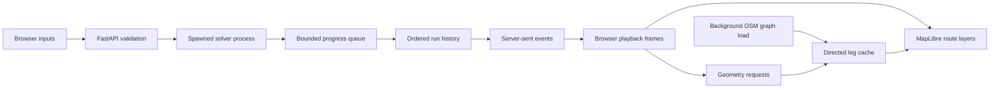

# Web application architecture and protocol

## Source layout

```text
Web/
  __main__.py             python -m Web entry point
  serve_orienteering.py   launcher, browser opening, loopback server
  app.py                 validation, processes, cache lifecycle, HTTP/SSE
  road_paths.py          coordinate loading and directed OSM reconstruction
  types.py               typed Python request/event/response contracts
  assets/
    index.html           form, map, inspector, playback controls
    app.js               map interaction and cumulative frame playback
    contracts.js         matching JSDoc contracts; no runtime import
    app.css              responsive visual layout
    vendor/              pinned MapLibre distribution and license
```

The core algorithms remain in `src/busroute/routing/`. `Web` is an installable
root-level package alongside the existing `src` packages. Use the repository's
editable installation (`uv run` or `pip install -e '.[web]'`): package data
includes browser assets, while routing data and configuration remain in the
checkout rather than being bundled into a standalone deployment.

## Data flow and lifecycle



Location metadata loads before the graph. One background initializer loads or
downloads the configured OSM graph and snaps matrix locations to it. Run inputs
can be used while the map is interactive; geometry readiness is reported
separately. Geometry endpoints run off the asynchronous API loop and serialize
access to the shared path cache.

One solver process runs at a time. A parent collector assigns a protocol version
and monotonic event sequence. The latest run and its history remain in memory
until a new run replaces them. Replacing a completed run makes its old URL return
404; downloading its result first preserves the JSON independently.

Stop sets a cooperative cancellation flag. If a worker does not exit promptly,
the parent terminates it with bounded waits. Shutdown also stops the current
worker. An SSE disconnection ends that subscription; reconnecting can resume
from the last event ID. Closing the page sends a best-effort stop request.

## Typed contracts and units

`Web/types.py` defines algorithm names, parameters, route snapshots, sparse
progress events and HTTP payloads. `Web/assets/contracts.js` documents the same
shapes for browser tooling. Python call signatures and application state are
annotated, and Google-style docstrings describe arguments, results and failures.

- Solver keys are `alns`, `vns`, `aco`, and `dijkstra`.
- API budgets and snapshot durations use minutes; core solver budgets use seconds.
- Departure strings use local `HH:MM`; the core receives minutes after midnight.
- Coordinate loaders return `(latitude, longitude)` pairs.
- GeoJSON road coordinates use `(longitude, latitude)` order.
- Missing road geometry is `null`, not a synthetic line or a zero-length route.
- `iteration` counts heuristic steps; `expanded` counts Dijkstra queue pops.

The recursive JSON type has an explicit runtime alias so Pydantic can produce
a complete response schema, including arbitrary nested boundary GeoJSON.
The local `/docs` and `/openapi.json` routes expose the generated API reference.

## HTTP endpoints

- `GET /` serves the application; `/assets/` serves bundled resources.
- `GET /api/bootstrap` returns matrix locations, defaults, boundary and status.
- `GET /api/status` reports graph readiness, timing and cache diagnostics.
- `POST /api/geometry` accepts `legs: [[from_id, to_id], ...]`, up to 200 pairs.
  Its response contains available MultiLineString geometries and missing-path
  explanations. Reversed point pairs are separate cache keys.
- `POST /api/runs` validates inputs and returns a new run ID. An active run causes
  HTTP 409; unknown endpoints or invalid inputs cause HTTP 422.
- `GET /api/runs/{id}/events` streams ordered progress. The `after` query parameter
  and `Last-Event-ID` header allow resumption after previously consumed events.
- `POST /api/runs/{id}/stop` stops computation while retaining recorded steps.
- `GET /api/runs/{id}/result` downloads `route.json` after success; otherwise 409.

Every streamed event contains `event`, `version`, `sequence`, and `algorithm`.
Depending on its kind, it can also contain route snapshots, operator names,
acceptance decisions, neighbourhood size, temperature, pheromone summary or
expanded-label counts. Events end with `result`, `error`, or `stopped`.

The browser folds sparse events into cumulative frames. Geometry requests are
deduplicated, batched and cached. A run generation plus render token prevents
late asynchronous geometry responses from replacing a newer run or seek target.
The map remains in place while its existing sources change.
