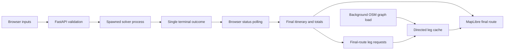

# Web application architecture

## Source layout

```text
Web/
  __main__.py             python -m Web entry point
  serve_orienteering.py   launcher, browser opening, loopback server
  app.py                 validation, isolated jobs, cache lifecycle, REST API
  road_paths.py          coordinates and directed OSM reconstruction
  types.py               typed Python request/result/response contracts
  assets/
    index.html           inputs, map, final-route guide
    app.js               job polling, map interaction and final-route rendering
    contracts.js         matching JSDoc contracts; no runtime import
    app.css              responsive visual layout
    vendor/              pinned MapLibre distribution and license
```

The core algorithms remain in `src/busroute/routing/`. `Web` is an installable
root-level package alongside the existing `src` packages. Use the checkout's
editable installation (`uv run` or `pip install -e '.[web]'`): browser assets
are package data; routing data and configuration remain in the checkout.

## Final-only data flow



Location metadata loads before the graph. One background initializer loads or
fetches the configured graph and snaps matrix locations to it. The map and form
stay usable while road geometry initializes. Geometry requests run off the API
loop and serialize access to the shared path cache.

One solver process runs at a time. Detailed tracing is disabled; lightweight
progress callbacks only check cancellation and immediately discard their data.
The child queues exactly one completed result or error. The parent retains only
status, final result and failure message: there is no event history, SSE stream,
operator visualization, chart or playback loop in the web app.

The browser polls the current run every 350 ms while connected and retries
interrupted requests after 1.5 seconds. Terminal results stop polling. The latest
run remains in memory until replaced; old run URLs then return 404. Downloading
its JSON first preserves the result independently.

Cancel sets a cooperative flag, with bounded process termination as fallback.
Shutdown stops the current worker. Closing the page sends a best-effort stop.
A successful result that completed before cancellation remains successful.

## Typed contracts and units

`Web/types.py` defines solver names, parameters, route snapshots and HTTP
payloads. `Web/assets/contracts.js` documents the matching browser shapes.
Python signatures and mutable state are annotated; Google-style docstrings
cover arguments, returns and failures. `/docs` and `/openapi.json` expose the
API reference. The recursive JSON type has a runtime alias for boundary GeoJSON.

- Solver keys: `alns`, `vns`, `aco`, `dijkstra`.
- API budgets and result durations: minutes; core budgets: seconds.
- Departures: local `HH:MM`, converted to minutes after midnight.
- Loaded coordinates: `(latitude, longitude)`; GeoJSON: `(longitude, latitude)`.
- Missing geometry: `null`, with a reason; never a synthetic straight line.

## HTTP endpoints

- `GET /` and `/assets/`: application and bundled assets.
- `GET /api/bootstrap`: matrix locations, defaults, ring boundary and status.
- `GET /api/status`: graph readiness, initialization timing and cache diagnostics.
- `POST /api/geometry`: `legs: [[from_id, to_id], ...]`, at most 200 pairs.
  Returns MultiLineString geometries or explicit missing-path explanations.
  Reversed pairs have separate cache keys.
- `POST /api/runs`: validated inputs; returns a new run ID. Active computation
  causes HTTP 409; unknown locations or invalid parameters cause HTTP 422.
- `GET /api/runs/{id}`: `{status, result, message}`. Status is `running`,
  `result`, `error`, or `stopped`. Only success supplies a final route;
  failure supplies a message. Running/cancelled responses have no route.
- `POST /api/runs/{id}/stop`: cancel and return terminal/already-completed status.
- `GET /api/runs/{id}/result`: download `route.json` after success; otherwise 409.

The former `/events` endpoint has been removed. The CLI and optional native
viewer retain their own progress facilities; the core solvers are unchanged.

## Completed-route guide

Success immediately opens a Google Maps-style itinerary: endpoint names,
algorithm, departure and budget, total travel time, stop count, POI score, and
an ordered list with numbered start/intermediate/destination stops. These same
numbers appear on the map. Select a stop or use Previous/Next to focus it and
highlight its marker. Fit route changes the camera explicitly; receiving the
result or its road geometry preserves the current viewport. Edit search opens
the input panel; starting a new accepted run clears the previous result.

Only one blue final-route overlay is displayed. The map retains the basemap,
location markers, central ring and final numbered stops. Geometry requests are
batched, deduplicated and cached. A run generation and render token prevent old
asynchronous responses from replacing a newer run. Existing map sources update
without rebuilding the map.

The itinerary is available even while roads load or geometry fails. Missing
legs are named and left as visible gaps; request failures offer Retry road path.
Basemap failures have their own explicit notice and Retry map action. Failed or
cancelled searches do not create an itinerary. On mobile the guide becomes a
scrollable bottom sheet; opening it collapses settings to leave map space.

The guide describes planned stops, not street-by-street navigation. Travel time
excludes visits, and credited POIs can include locations passed along legs that
are not explicit stops. All totals come from the OD matrix; OSM road paths are
approximate reconstructions.
